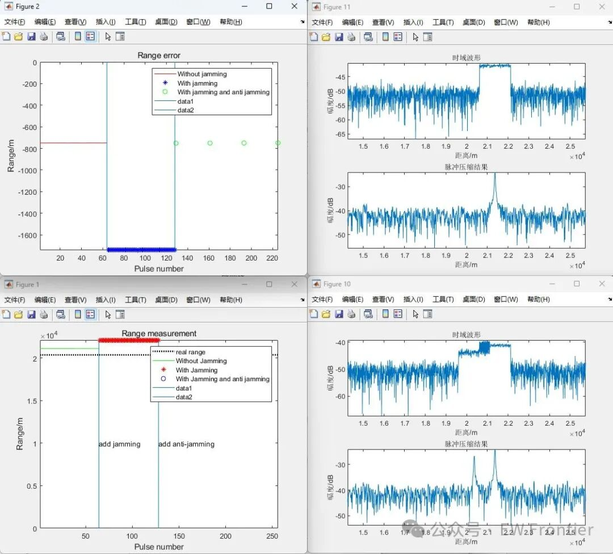

# [Radar Interference Reduction]Frequency Synchronization and Distance False Target Interference Effect Verification[With MATLAB Code]

- Output only - do not answer, do not write a guide, do not add anything:
Due to the fact that jamming from the same frequency step occurs at the same position within a continuous PRI, by changing the PRT of the radar transmit signal and ensuring that the change in PRT is within the maximum unambiguous range of the target distance, the relative delay between the echoes of the pseudo targets and the true targets changes. This aligns the envelope of the mixed signal received by the radar receiver, resulting in adjacent pseudo targets appearing at different range cells. By appropriately changing the PRT, the anti-jamming method is the same as that against coherent and asynchronous jamming. That is, through non-coherent accumulation, the amplitude of the target echo pulse is enhanced. After CFAR processing, it may only be the threshold for the target pulse, achieving the purpose of eliminating interference signals.
Effective demonstration:
Distance pseudo-target interference does not affect Doppler radar speed measurement but greatly affects radar ranging. Therefore, the main countermeasure is carried out on the range dimension. As long as the range measurement error is within the allowable range after anti-jamming, it indicates that the anti-jamming is successful.
Comparison results of real target distance, undisturbed distance measurement values, distance measurement values with interference without countermeasures, and distance measurement values with interference with countermeasures.
Comparison chart of range measurement errors.
MATLAB simulation results:
References:
[1] Zhong Lin. Research on radar tracking technology of space targets under distance deception jamming [D]. National University of Defense Technology, 2015.
[2] Shi Xiaofang. Anti-jamming characteristics identification and countermeasure methods for radar tracker jamming [D]. Xi'an University of Electronic Science and Technology, 2019.DOI:10.27389/d.cnki.gxadu.2019.000808.

## Images

<!-- PAYMENT_BLOCK -->

## Get this dataset

- Payment link (Stripe): [Buy now](https://buy.stripe.com/3cs8yP7sY87d0vu9AB)
- Payment QR code: 

<!-- /PAYMENT_BLOCK -->
